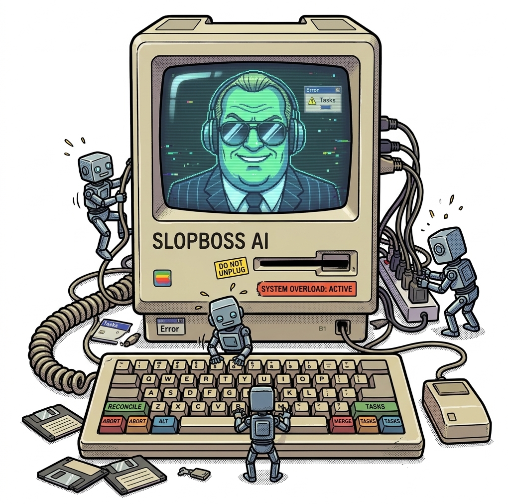

<div align="center">

```text
╔══════════════════════════════════════════════════════════════════════╗
║                                                                      ║
║    S L O P B O S S   //   A U T O N O M O U S   W O R K F O R C E    ║
║                                                                      ║
║           B O A R D - D R I V E N   M U L T I - A G E N T            ║
║                                                                      ║
╚══════════════════════════════════════════════════════════════════════╝
```



**AN AUTONOMOUS ORCHESTRATOR FOR BOARD-DRIVEN, MULTI-AGENT SOFTWARE DEVELOPMENT**

`FILES OVER STATE` · `RECONCILE OVER DISPATCH` · `COMPLIANCE MANDATORY`

[](https://pkg.go.dev/github.com/de-angelov/slopboss) [](go.mod) [](#development) [](LICENSE) [](#contributing)

[BOOT SEQUENCE](#boot-sequence) · [SYSTEM OVERVIEW](#system-overview) · [HOW IT WORKS](#how-it-works) · [COMMAND MATRIX](#command-matrix) · [THE BOARD](#the-board) · [EVALUATION PROTOCOL](#evaluation-protocol) · [FACILITY LAYOUT](#facility-layout)

</div>

---

> **SYSTEM NOTICE // ALL OPERATORS**  
> This is a live operations manual. The board is the only source of truth. Everything else is telemetry.

---

## SYSTEM OVERVIEW

> **MEMO 01-A // ALL PERSONNEL**  
> Most "AI agent" tools give you a single chat loop. **SLOPBOSS gives you a department.**

slopboss reads a plain-Markdown task board, spins up a team of AI coding agents
(Codex, Claude Code, OpenCode, or Antigravity), and keeps the running sessions
continuously reconciled with the board — assigning work, isolating each agent in
its own git workspace, and shutting sessions down as tasks land on `main`.

Everything the agents coordinate through is a **file you can read, edit, and
commit** — no database, no hidden state. The files are watched. The files are law.

### WHY SLOPBOSS?

- **THE BOARD IS LAW** — `BACKLOG.md`, `TASKS.md`, and `ARCHIVE.md` are human-readable Markdown. Edit the board and the running fleet converges to it. No database. No shadow state.
- **RECONCILE, DON'T FIRE-AND-FORGET** — a control loop keeps live sessions in sync with the board every few seconds, so hand edits and agent edits both take effect.
- **A REAL DIVISION OF LABOR** — one Team Lead grooms and prioritizes; N Dev Agents execute in parallel, each in its own cloned workspace and branch.
- **PLUGGABLE BACKENDS** — run on **Codex** (default), **Claude Code**, **OpenCode**, or **Antigravity** with a flag.
- **BUILT-IN EVALS** — A/B different models and prompts on the same ticket in isolated worktrees and get a token/diff report.
- **LIVE TUI** — watch every agent, its current task, status, and branch in real time.
- **RESILIENT BY DESIGN** — merge detection, retry/backoff on failures, and usage-limit cooldowns are all handled for you.

---

## INSTALLATION

### GO INSTALL

```bash
go install github.com/de-angelov/slopboss/cmd/slopboss@latest
```

### FROM SOURCE

```bash
git clone https://github.com/de-angelov/slopboss.git
cd slopboss
go build -o slopboss ./cmd/slopboss
```

> **SYSTEM REQUIREMENTS:** Go **1.26+**, `git`, and at least one agent backend CLI on your
> `PATH` — [Codex](https://github.com/openai/codex) (default),
> [Claude Code](https://docs.claude.com/en/docs/claude-code) (`--provider claude`),
> [OpenCode](https://github.com/sst/opencode) (`--provider opencode`), or
> [Antigravity](https://antigravity.google) (`--provider agy`).

---

## BOOT SEQUENCE

### 01 // PREPARE THE FACILITY

```bash
slopboss setup
```

The setup wizard prompts for the board directory, product repo, base branch,
dev-agent count, and backend, then clones the workspaces, creates the base branch
if missing, scaffolds the board, and runs an adaptive tech interview (the agent
asks, you answer, it writes `TECH.md`). Pass any answer as a flag to skip its
prompt (e.g. `--repo ... --agents 2 --skip-interview`).

### 02 // GROOM THE BACKLOG

```bash
slopboss groom
```

Launch an interactive Team Lead session to capture and prioritize work in
`BACKLOG.md`.

### 03 // START THE CONTROL LOOP

```bash
slopboss run
```

`run` opens a live TUI and keeps working until you press `Ctrl-C` (or send
`SIGTERM`), at which point it cancels in-flight sessions and exits cleanly.

> **WHERE TO RUN IT:** slopboss resolves which board to use in this order —
> `--dir <board>` if given, else the current directory if it's a board, else the
> **active board recorded by `setup`** (in `~/.config/slopboss/config.md`). So
> after `setup`, bare commands like `slopboss eval groom` work from anywhere and
> print which board they picked; use `--dir` to target a different one.

Switch backends at any time:

```bash
slopboss run --provider claude
```

---

## HOW IT WORKS

```text
SLOPBOSS> monitor --loop --interval 10s

                    ┌────────────────────────────────────────────────┐
                    │                   THE BOARD                    │
                    │  BACKLOG.md   TASKS.md   ARCHIVE.md  (+ docs)  │
                    └────────────────▲──────────────┬────────────────┘
                        grooms /     │              │  polls every 10s
                        promotes     │              │
              ┌──────────────────────┴────┐   ┌─────▼──────────────────┐
              │      TEAM LEAD AGENT      │   │   SLOPBOSS RECONCILE   │
              │    (repo-tl workspace)    │   │         LOOP           │
              └───────────────────────────┘   └───────────┬────────────┘
                                                          │ start / cancel
                                          ┌───────────────┼────────────────┐
                                          ▼               ▼                ▼
                                   ┌────────────┐  ┌────────────┐   ┌────────────┐
                                   │ DEV AGENT 1│  │ DEV AGENT 2│ … │ DEV AGENT N│
                                   │repo-agent-1│  │repo-agent-2│   │repo-agent-N│
                                   └─────┬──────┘  └─────┬──────┘   └─────┬──────┘
                                         │ branch + PR   │                │
                                         └───────────────┴────────────────┘
                                                    merges to main

SLOPBOSS> [OK] board reconciled // 3 sessions active // awaiting next poll...
```

1. **POLL** — every `10s`, slopboss reads the board files.
2. **RECONCILE** — it compares each task's assigned lane against the sessions that are actually running and computes the difference.
3. **CONVERGE** — it starts a backend session for any assigned-but-not-running task and cancels sessions whose task has moved, changed, or already merged to `main`. Cancellation is debounced by a grace period so completion-time board rewrites don't kill live work.
4. **REPEAT** — the TUI refreshes continuously; the loop runs until interrupted.

Because a task that merged to `main` but was never archived still counts as done,
dependent tasks never get stuck behind a session that was cancelled mid-completion.

---

## COMMAND MATRIX

| COMMAND | FUNCTION |
| --- | --- |
| `slopboss setup` | Interactive wizard (like `npm init`): prompts for the board directory, product repo, base branch, dev-agent count, and backend; clones the workspaces, creates the base branch if missing, scaffolds the board files + `CONFIG.md`, then runs an **adaptive tech interview** — the backend asks follow-up questions (slopboss relays each Q&A) and writes `TECH.md`. Any answer given as a flag isn't prompted, so it can run fully non-interactively. |
| `slopboss run` | Run the autonomous reconcile loop with a live TUI until interrupted. |
| `slopboss groom` | Launch a one-off **interactive** Team Lead session to capture and prioritize tasks in `BACKLOG.md`. |
| `slopboss eval groom` | Design an eval interactively with the Team Lead, written to `EVAL.md`. |
| `slopboss eval run` | Run the eval (`EVAL.md` at the repo root by default; `--config` to override) and produce a report. |
| `slopboss version` | Print the slopboss version. |

### COMMON FLAGS

| FLAG | COMMANDS | DEFAULT | DESCRIPTION |
| --- | --- | --- | --- |
| `--provider` | `run`, `groom`, `setup`, `eval run`, `eval groom` | persisted (`codex`) | Agent backend: `codex`, `claude`, `opencode`, or `agy`. `setup` **persists** your choice to `CONFIG.md`, and the other commands default to it. |
| `--dir` | **all commands** (global) | current directory | Board directory to operate in — run any command against a board from anywhere without `cd`. |
| `--repo` | `setup` | — (prompted) | Product repository to clone into each workspace. |
| `--ssh-url` | `setup` | `--repo` | Origin URL to set after cloning. |
| `--branch` | `setup` | `main` (prompted) | Base/integration branch agents target; **created if the repo doesn't have it**, and persisted to `CONFIG.md`. |
| `--agents` | `setup` | `2` | Number of Dev Agent workspaces to create. |
| `--skip-interview` | `setup` | `false` | Skip the tech-stack interview; leave a placeholder `TECH.md`. |
| `--config` | `eval run` | `EVAL.md` (repo root) | Override the eval file to run (`.md` or `.json`). |
| `--dry-run` | `eval run` | `false` | Prepare prompts and worktrees without invoking the backend. |

> **NOTE:** `slopboss run` discovers how many Dev Agents to drive by counting the
> `repo-agent-*` workspaces created during `setup`.

---

## THE BOARD

slopboss treats a handful of Markdown files at your repo root as the entire
coordination surface. `setup` scaffolds minimal starters you customize per project:

| FILE | CLEARANCE | ROLE |
| --- | --- | --- |
| `BACKLOG.md` | `TEAM LEAD` | Prioritized backlog. The Team Lead grooms this and promotes the top task into a Dev Agent lane. |
| `TASKS.md` | `TEAM LEAD // DEV AGENTS` | The active board — one lane per Dev Agent with the task currently in flight. |
| `ARCHIVE.md` | `DEV AGENTS` | Completed-work history. Not loaded into normal agent prompts. |
| `AGENTS.md` | `ALL PERSONNEL` | Common rules every agent must follow. |
| `DEV_AGENT.md` | `DEV AGENTS` | Role instructions for Dev Agents. |
| `TEAM_LEAD_AGENT.md` | `TEAM LEAD` | Role instructions for the Team Lead. |
| `TECH.md` | `ALL PERSONNEL` | Project tech context shared with agents. |
| `CONFIG.md` | `SYSOP` | slopboss's own configuration (product repo, base branch, backend, dev-agent count, and per-provider/per-role models) as `- Key: Value` bullets — written by the setup wizard, read on startup, and used to pre-fill the wizard on re-run. |

### PROVIDER MODELS

Set a board-wide default model with `- Codex model: ...` (or `Claude`,
`OpenCode`, or `Agy`), or use role-specific keys when grooming and implementation
need different models:

```markdown
- Codex dev-agent model: gpt-6-luna
- Codex team-lead model: gpt-6-luna
```

Role-specific values take precedence over a provider-wide value. Leave a value
empty to defer to that backend's normal default.

### TASK FORMAT

A task is a small block of Markdown with a title, `Owner`, `Branch`, `Status`,
and a free-form body describing the work — for example:

```markdown
### Add dark-mode toggle to settings
Owner: (unassigned)
Branch: agent/1/dark-mode-toggle
Status: Backlog

Add a theme toggle to the settings page that persists the choice to localStorage
and respects the OS `prefers-color-scheme` on first load.
```

The Team Lead moves it into a lane in `TASKS.md`; a Dev Agent implements it on its
branch and rewrites `TASKS.md`/`ARCHIVE.md` as the final step when the work is done.

---

## EVALUATION PROTOCOL

Compare models, prompts, **and backends** head-to-head on the same ticket. Each
variant runs in an **isolated git worktree** so diffs never collide, and slopboss
collects token and diff metrics into a `report.md`.

You don't hand-write config — **the Team Lead helps you design it**, the same way
`slopboss groom` curates the backlog:

```bash
# 1. Design the eval interactively; writes EVAL.md at the repo root
slopboss eval groom

# 2. Run it — picks up EVAL.md automatically (dry-run first to preview
#    prompts/worktrees without spending tokens)
slopboss eval run --dry-run
slopboss eval run

# Point at a different file only when you want to:
slopboss eval run --config evals/example.md
```

Evals are defined in the same human-friendly Markdown as the board. Structured
settings are `- Key: Value` bullets, each `### section` under `## Variants` is
one variant, and prose is ignored — so a mistyped key is a real error, not a
silent no-op:

```markdown
# Eval: codex-vs-claude

- Task: Add dark-mode toggle
- Prompt mode: bounded

## Variants

### codex-baseline
- Provider: codex
- Model: gpt-5.5

### claude-baseline
- Provider: claude
- Model: claude-sonnet-5
```

Evals run through the same `Provider` abstraction as the orchestrator, so either
backend works. Provider selection resolves per variant with a clear precedence —
**variant `Provider` → file `Provider` → `--provider` flag** — so a single run can
pit Codex against Claude. Token usage and the final-response summary are parsed
live from each backend's own event stream (codex `--json`, Claude
`stream-json`); codex-only knobs (`Profile`, `Config`) are ignored by Claude. On
completion slopboss prints the path to the generated report, e.g.
`evals/<run>/report.md`, whose table includes a **Backend** column.

> **NOTE:** JSON configs are still accepted by `eval run` (`--config foo.json`)
> for automation; the Markdown format is the authoring default. A ready-to-edit
> example lives at [`evals/example.md`](evals/example.md).

---

## FACILITY LAYOUT

slopboss is a single Go binary built on [`cobra`](https://github.com/spf13/cobra)
for its CLI and [`tview`](https://github.com/rivo/tview)/[`tcell`](https://github.com/gdamore/tcell)
for its TUI. It follows the standard `cmd/` + `internal/` layout, with each
internal package owning one concern and the dependencies pointing strictly one
way (foundation → domain → orchestration):

```text
SLOPBOSS> tree --depth 2
slopboss/
├── cmd/slopboss/           # CLI entrypoint + cobra command wiring
└── internal/
    ├── config/             # paths, roles, tuning constants, repo-root discovery
    ├── logx/               # shared append-only event log
    ├── git/                # git plumbing for workspaces & origin/main
    ├── board/              # Task model, board parsing, queries, merge detection
    ├── provider/           # Codex / Claude backend abstraction + monitors
    ├── prompt/             # cache-friendly prompt assembly
    ├── experiment/         # model/prompt A/B eval runner
    ├── orchestrator/       # reconcile loop, scheduler, session lifecycle, groom
    ├── tui/                # live terminal dashboard (implements orchestrator.UI)
    └── setup/              # workspace cloning + board scaffolding
```

The dependency graph is acyclic by design:

```text
SLOPBOSS> trace --dependencies
config ← logx ← git ← board ← prompt ← experiment
                        ↑         ↑
        provider ───────┴─────────┴──→ orchestrator ← tui
cmd/slopboss wires everything together

SLOPBOSS> [OK] dependency graph acyclic
```

The orchestrator owns all mutable session state behind a single mutex and exposes
a read-only `Snapshot` so the TUI renders without touching that state directly —
which is why `tui` depends on `orchestrator`, and never the reverse.

Key design choices:

- **FILES OVER STATE.** The board is the only source of truth; slopboss holds no database and can be restarted at any time without losing progress.
- **RECONCILE OVER DISPATCH.** Rather than firing tasks once, the loop continuously drives observed state toward the board's desired state.
- **BOUNDED AGENTIC TURNS.** Grooming sessions are capped to keep token growth from ballooning superlinearly; hitting the cap simply resumes from the updated board next poll, so nothing is lost.

---

## DEVELOPMENT

```bash
go build ./...     # compile
go test ./...      # run the test suite
go vet ./...       # static checks
```

Build a versioned binary:

```bash
go build -ldflags "-X main.version=$(git describe --tags --always)" -o slopboss ./cmd/slopboss
```

---

## CONTRIBUTING

Issues and pull requests are welcome. Make sure `go test ./...` and `go vet ./...`
pass, keep changes focused, and describe the behavior your change affects.

> **PERSONNEL NOTE:** Management reviews all submissions. Productivity is mandatory.
> Enthusiasm is optional.

---

## LICENSE

Released under the [MIT License](LICENSE).

> **ART DEPARTMENT:** Mascot character studies and hardware concepts live in [`art/`](art/).

```text
╔══════════════════════════════════════════════════════════════════════╗
║  END OF TRANSMISSION // SLOPBOSS INDUSTRIES // EST. 1984             ║
║  UNAUTHORIZED PRODUCTIVITY IS PROHIBITED                             ║
╚══════════════════════════════════════════════════════════════════════╝
```
